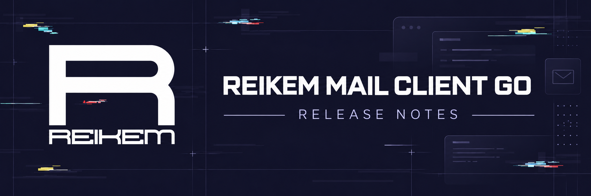

# GitHub-Einrichtung

Ziel ist `rkstraessler/ReikemMailClient_GO` mit Default-Branch `main`. Die Dateien unter `.github/` enthalten CI, autofix.ci, Dependabot, CODEOWNERS und Release-Notizen.

## Repository und Schutzregeln

1. Initialen Projektstand nach `main` übertragen und den Branch als Default festlegen. Nach dem ersten grünen Lauf auf GitHub ist der Check **Required CI** aus dem Workflow **CI** auswählbar.
2. Unter **Settings → General → Pull Requests** die Optionen **Allow squash merging**, **Allow auto-merge** und **Automatically delete head branches** aktivieren. **Allow merge commits** und **Allow rebase merging** deaktivieren. Die Option zum Anzeigen von **Update branch** kann aktiviert werden.
3. Unter **Settings → Actions → General → Workflow permissions** den Standard **Read repository contents and packages permissions** verwenden. **Allow GitHub Actions to create and approve pull requests** bleibt deaktiviert.
4. Unter **Settings → Rules → Rulesets** ein aktives Branch-Ruleset `Main review and CI` für `main` anlegen. Als einzigen Bypass-Akteur **Repository admin** mit **Always allow** aufnehmen. Für **Require a pull request before merging** ein genehmigendes Review, das Verwerfen veralteter Freigaben und das Auflösen aller Review-Kommentare aktivieren. **Squash** als Merge-Methode zulassen. CODEOWNERS fordert den Repository-Owner als Reviewer an. Das separate Pflichtreview durch Code Owners bleibt für die eingegrenzte Dependabot-Freigabe deaktiviert.
5. Im selben Ruleset **Require status checks to pass** aktivieren. **Required CI** mit **GitHub Actions** als erwarteter Quelle und **Require branches to be up to date before merging** auswählen. `Required CI` umfasst Formatierung, `go vet`, Tests, Race-Tests, Build, Modulprüfung, Schwachstellenscan und Workflow-Lint. Bei PRs ist zusätzlich die Abhängigkeitsprüfung Teil des erforderlichen Checks.
6. Ein zweites aktives Branch-Ruleset `Main history` für `main` mit **Restrict deletions** und **Block force pushes** ohne Bypass-Akteure erstellen. Damit gilt der Verlaufsschutz auch für Administratoren. [GitHub-Regeln für Rulesets](https://docs.github.com/en/repositories/configuring-branches-and-merges-in-your-repository/managing-rulesets/available-rules-for-rulesets)
7. Labels bei Bedarf aus dem Workspace mit `bash .github/scripts/sync-labels.sh` abgleichen. Das Skript benötigt Zugriff auf das Go-Repository und gleicht die 14 im Projekt verwendeten Labels ab.
8. Unter **Settings → Advanced Security** den Dependency Graph, Dependabot Alerts und Dependabot Security Updates aktivieren. Die Versionsprüfung für Go-Module und GitHub Actions läuft täglich um 03:00 Uhr in `Europe/Berlin`. Patch- und Minor-Updates werden je Ökosystem gebündelt, Major-Updates landen in getrennten PRs. Security-Gruppen werden als `security` gekennzeichnet. [Dependabot-Optionen](https://docs.github.com/en/code-security/reference/supply-chain-security/dependabot-options-reference)

## Schutz der Dependabot-Freigabe

1. Unter **Settings → Environments** das Environment `dependabot-maintenance` erstellen. Für **Deployment branches and tags** die Einstellung **Selected branches and tags** wählen und ausschließlich die Branch-Regel `main` hinzufügen. Die Jobs verwenden den vertrauenswürdigen `main`-Stand für Metadaten und führen dabei keinen PR-Code aus.
2. Ein Maintainer mit Push-Zugriff erstellt auf GitHub ein zeitlich begrenztes Fine-grained Personal Access Token für genau `ReikemMailClient_GO`. Unter **Repository permissions** ist für **Pull requests** `Read and write` erforderlich. GitHub fügt den Metadatenzugriff hinzu. Im Environment das Secret `DEPENDABOT_MAINTAINER_TOKEN` hinterlegen. [Fine-grained Personal Access Tokens](https://docs.github.com/en/authentication/keeping-your-account-and-data-secure/managing-your-personal-access-tokens) · [PR-Review-API](https://docs.github.com/en/rest/pulls/reviews#create-a-review-for-a-pull-request)
3. Der Workflow prüft signierte Dependabot-Commits und klassifiziert den höchsten SemVer-Sprung. Bei Patch und Minor wartet er auf **Required CI** für den aktuellen Commit, prüft erneut Mergefähigkeit und Review-Status und genehmigt genau diesen Commit. GitHub übernimmt anschließend Squash-Auto-Merge unter den normalen Ruleset-Bedingungen. Major-Updates, nicht klassifizierbare Commits, Abhängigkeiten mit Maintainer-Wechsel und nachträglich manuell oder von autofix.ci geänderte Dependabot-Branches brauchen ein menschliches Review. Ohne Environment-Secret ist für die Review-Freigabe ebenfalls ein Maintainer erforderlich. [GitHub-Automatisierung für Dependabot](https://docs.github.com/en/code-security/tutorials/secure-your-dependencies/automate-dependabot-with-actions)
4. Bei einem Push nach `main` fordert der Workflow für veraltete, unveränderte Dependabot-Branches ein `@dependabot rebase` an. Ein stündlicher Kontrolllauf deckt auch Merges ab, deren Push kein Workflow-Ereignis auslöst. Dependabot erzeugt den neuen signierten Commit, worauf PR-CI erneut läuft. GitHub blockiert Konflikte und Branches mit veralteter Basis. Dependabots eigener Rebase-Zeitplan greift zusätzlich. [Dependabot-PR-Kommandos](https://docs.github.com/en/code-security/how-tos/secure-your-supply-chain/manage-your-dependency-security/manage-dependabot-prs) · [Ereignisse des GitHub-Tokens](https://docs.github.com/en/actions/concepts/security/github_token)

## autofix.ci

Die [autofix.ci GitHub App](https://github.com/apps/autofix-ci) installieren und unter **Only select repositories** `ReikemMailClient_GO` wählen. Der Workflow `autofix.ci` formatiert die Go-Dateien auf PR-Heads mit `gofmt`. Die App schreibt nur bei Änderungen auf den PR-Branch. Ihr Push löst die PR-Prüfungen erneut aus. Dasselbe gilt für Dependabot-PRs, soweit die App Schreibzugriff auf deren Branch hat. [autofix.ci-Setup](https://autofix.ci/setup)

## Releases nach Freigabe

1. Den geprüften Commit auf `main` für den freigegebenen SemVer-Tag verwenden. Der aktuelle Importpfad gilt für `v0` und `v1`. Ab `v2` zuerst `go.mod`, Imports und Beispiele auf den entsprechend versionierten Suffix umstellen. Veröffentlichte Go-Tags sind unveränderlich. [Go-Modulversionen](https://go.dev/ref/mod#versions)
2. Unter **Releases → Draft a new release** den freigegebenen Tag auswählen und **Generate release notes** verwenden. GitHub gruppiert die PRs gemäß `.github/release.yml`. [GitHub Release Notes](https://docs.github.com/en/repositories/releasing-projects-on-github/automatically-generated-release-notes)
3. Den [REIKEM-Release-Banner](../.github/assets/release-banners/reikem-mail-client-go-release-banner.png) am Anfang der Release-Notizen einfügen. Ersetze `COMMIT_SHA` durch den vollständigen SHA des freigegebenen Commits. Der commitgebundene Link hält frühere Release-Notizen bei späteren Designänderungen stabil.

   ```markdown
   
   ```

4. Release-Notizen prüfen und nach Freigabe veröffentlichen. Der Quellcode und `go.mod` im Tag bilden das installierbare Go-Modul.

<details>
<summary>ImageGen-Prompt für den Release-Banner</summary>

Der wiederverwendbare 3:1-Banner wurde mit dem integrierten ImageGen-Werkzeug aus der Stilvorlage und dem REIKEM-Logo erzeugt.

```text
Use case: ads-marketing. Design the finished reusable GitHub release-notes banner for the REIKEM Mail Client Go SDK. Two input images: image 1 is a layout and style reference from a sibling project, image 2 is the actual REIKEM brand mark. Match image 1's very wide 3:1 edge-to-edge landscape, midnight navy and indigo technical grid, faint outlined panels and restrained small cyan, lavender, pale yellow and red glitch accents. The image must read cleanly around 800 px wide. Reproduce the complete white REIKEM logo from image 2 faithfully on the left: preserve the exact geometric R and futuristic REIKEM wordmark, including their proportions and alignment. Use the reference's visual hierarchy on the right. Set exactly "REIKEM MAIL CLIENT GO" in one line of strong white angular sans-serif, sized to fit with generous side clearance. Set exactly "RELEASE NOTES" below in airy, widely tracked pale lavender lettering, flanked by short thin horizontal lines. A very faint outlined envelope motif can replace the code icon in the far-right background. Keep the mark and lettering crisp and high-contrast, balance the left and right halves, and leave clean margins. Aim for a true 3:1 wide PNG in the spirit of the supplied banner. The only other text is the REIKEM wordmark within the logo. No version, date, extra badges, slogans, watermark or fictitious interface copy.
```

</details>
